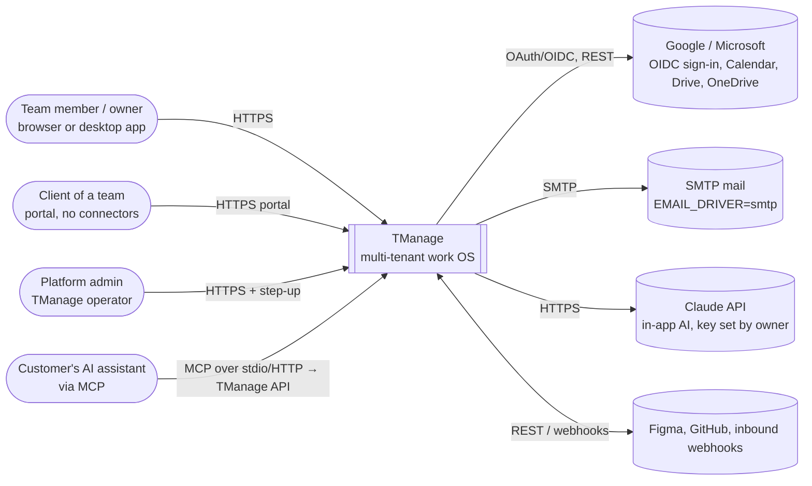
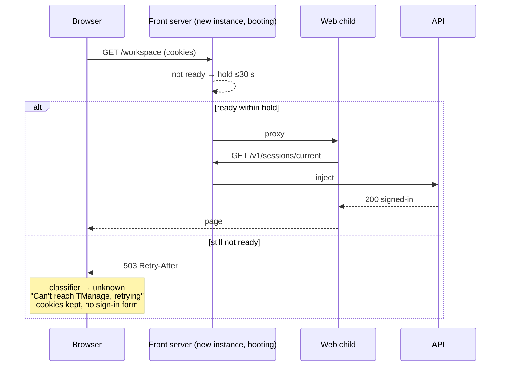

# TManage architecture views (C4)

Notation: the C4 model (Simon Brown, https://c4model.com/; S2 in `ENGINEERING-STANDARD.md` §1). It has System Context, Container, Component and Deployment views; the Code level is left to the code. The diagrams are Mermaid flowcharts, not Mermaid's experimental `C4Context` syntax, so they render in any viewer. Each element names the code that implements it.

Facts here are taken from the code on 2026-11-20. Unverified items are marked "(verify)".

## 1. System context



## 2. Containers (deployment on Hostinger shared hosting)

One Hostinger Node.js app (`apps/server/server.mjs`) serves the web, the API and the worker on one public port. Hostinger runs it **on demand**, stops it when idle, and restarts it on the next request or after a crash (S25). The launcher is not documented by Hostinger; `server.mjs:19-20` says it is LiteSpeed (verify).

```mermaid
flowchart TB
  subgraph host[Hostinger shared hosting · app folder hbuilds/current/nodejs]
    subgraph proc[Node process · apps/server/server.mjs · may be N≥1 during restarts]
      front[Front HTTP server<br/>listen first · startup hold ≤30 s · 503 + Retry-After<br/>web-transport.mjs]
      gate[Platform gate<br/>platform-gate.mjs]
      api[API · NestJS + Fastify in-process<br/>apps/api · /v1]
      worker[Worker · outbox relay, consumers<br/>apps/worker · started in-process]
      sweeps[Scheduled sweeps<br/>scheduled-sweeps.mjs · GET_LOCK per pass]
      rt[Realtime hub · /realtime<br/>realtime-inprocess.mjs]
    end
    webchild[Web child process · Next.js `next start`<br/>apps/web · unix socket .run/web.sock]
    disk[(Local disk storage<br/>STORAGE_DRIVER=local on live (verify) · packages/storage)]
    db[(MariaDB 11.8<br/>127.0.0.1:3306 · one DB user, full privileges · ADR-0007)]
  end
  desk[Desktop app · Electron<br/>apps/desktop · loads startUrl]
  mcp[MCP bridge · apps/mcp-server<br/>packed to /downloads/tmanage-mcp.tgz · runs on the user's machine]
  browser[Browser]
  browser --> front
  desk --> front
  mcp -->|HTTPS /v1 + personal access token| front
  front -->|/v1| api
  front -->|pages| gate --> webchild
  front -->|ws| rt
  webchild -->|HTTP /v1 server-side| front
  api --> db
  worker --> db
  sweeps --> db
  api --> disk
  worker -->|SMTP, OAuth APIs, Claude API| ext[(External services)]
```

| Container     | Code                                                               | Technology                             | Responsibilities                                                                    | Instance-unique resources (see RT-2)                        |
| ------------- | ------------------------------------------------------------------ | -------------------------------------- | ----------------------------------------------------------------------------------- | ----------------------------------------------------------- |
| Front server  | `apps/server/server.mjs`, `web-transport.mjs`                      | Node `http`                            | Listen first, hold or 503 during boot, route `/v1`, pages and `/realtime`, shutdown | Public port (owned by the host launcher)                    |
| Platform gate | `apps/server/platform-gate.mjs`                                    | Fastify `inject`                       | Hide the platform console from non-admins (404); tri-state since AUTHSTATE          | none                                                        |
| API           | `apps/api` (in-process)                                            | NestJS 11 + Fastify 5                  | Guard chain (`app.module.ts:1264-1270`), business services, repositories            | DB pool                                                     |
| Worker        | `apps/worker`                                                      | Node                                   | Outbox relay (`FOR UPDATE SKIP LOCKED`), consumers                                  | relay timer, heartbeat file (`server.mjs:463-470`)          |
| Sweeps        | `apps/server/scheduled-sweeps.mjs`                                 | Node timers + `GET_LOCK`               | Purge, reconcile, signals, budgets                                                  | in-memory hourly throttles (`:591-597`)                     |
| Realtime      | `apps/server/realtime-inprocess.mjs`                               | WebSocket                              | Live pushes                                                                         | **the hub itself**: clients on another instance miss pushes |
| Web child     | `apps/web` via `spawn` (`server.mjs:229`)                          | Next.js                                | Pages, server components, session check (`lib/session-check.ts`)                    | **socket path `.run/web.sock`** (`web-transport.mjs:83-86`) |
| MariaDB       | `apps/api/migrations`, `scripts/db/users.sql`                      | MariaDB 11.8 LTS                       | System of record, ledger, leases (`GET_LOCK`)                                       | —                                                           |
| Storage       | `packages/storage` (`local-root.ts`, `filesystem-object-store.ts`) | local disk (s3 driver for other hosts) | Files; customer Drive/OneDrive via connectors                                       | —                                                           |
| Desktop       | `apps/desktop/src/main.ts:188`                                     | Electron                               | Window around the web app, deep links, tray                                         | —                                                           |
| MCP bridge    | `apps/mcp-server/src/api-client.ts`                                | MCP SDK                                | Typed tools over the public API (SE-8)                                              | —                                                           |

## 3. Components: request path inside the API

```mermaid
flowchart LR
  req[HTTP /v1 request] --> th[DurableThrottleGuard<br/>rate-limits/durable-throttle.guard.ts]
  th --> se[SessionAuthGuard]
  se --> cs[CsrfGuard<br/>ADR-0004]
  cs --> tc[TenantContextGuard<br/>membership · ADR-0001]
  tc --> ts[TwoStepRequirementGuard]
  ts --> cap[CapabilityGuard<br/>@tmanage/domain policies]
  cap --> ctl[Controller<br/>no rules, no repositories · AR-6]
  ctl --> svc[Service<br/>rules · domain functions]
  svc --> repo[Repository<br/>only place with SQL · AR-4]
  repo --> tg[Tenant guard<br/>assertTenantScoped on bound values]
  tg --> db[(MariaDB)]
  svc --> ob[Outbox row in same tx · AS-1]
```

## 3b. Dynamic view: session check during a restart (target behaviour, SE-2)



## 4. Context map (DDD bounded contexts over the real modules)

There are 75 modules under `apps/api/src/modules`. They are grouped below into contexts by name and file layout (lane-B reading, 2026-11-20). Purposes marked "?" were inferred from names. `module-boundaries.mjs` (AR-5, to build) uses this table as its module→context map.

| Context                   | Modules                                                                                                                                    | Owns (core tables, indicative)                               | Upstream of                    |
| ------------------------- | ------------------------------------------------------------------------------------------------------------------------------------------ | ------------------------------------------------------------ | ------------------------------ |
| Identity & Access         | identity, google-auth, microsoft-auth, sso, scim, oauth, personal-access-tokens, setup, signup, portal-sign-in                             | users, sessions, factors, tokens                             | all (session)                  |
| Tenancy & People          | tenancy, people, preferences, working-calendar, onboarding, getting-started, storage-root (?), ai-employees (60-03)                        | organizations, memberships, invitations, roles, ai_employees | all (membership, roles)        |
| Work Management           | projects, work, work-views, iterations, decisions, approvals, requests, time, automations, import, activity, home, inbox, search, insights | projects, work_items, time entries                           | Portal, Finance, Collaboration |
| Collaboration             | conversations, chat, presence, realtime, notifications, calendar, google-calendar, microsoft-calendar, docs, unfurl                        | messages, notifications, meetings, docs                      | —                              |
| Client Portal             | clients, portal, public-links, public-forms                                                                                                | client organizations, portal projections                     | —                              |
| Files & Storage           | files, cloud-folders, google-drive, onedrive                                                                                               | files, uploads, usage counters                               | Work, Portal, Billing          |
| Integrations              | connectors, app-connect, figma, mcp, inbound-email, email-deliverability, mail-bounces                                                     | connections, inbound mail                                    | —                              |
| Billing & Finance         | billing, finance, quotes                                                                                                                   | plans, seats, invoices, expenses                             | —                              |
| AI                        | copilot, ai-actions                                                                                                                        | AI budgets, holds, actions                                   | —                              |
| Platform Operations       | platform (outbox), platform-admin, admin, rate-limits, support, product-events (?)                                                         | outbox_events, flags, platform settings                      | all (outbox)                   |
| Audit, Security & Privacy | audit, security-reports, security-signals, privacy, public-abuse                                                                           | audit_events (append-only), signals                          | all (audit)                    |
| Public Site               | public-site, pricing-survey                                                                                                                | —                                                            | —                              |
| Shared Kernel             | packages/domain (pure policies), packages/contracts (wire types); no module may own them alone                                             |                                                              |                                |
| Design System             | packages/ui (tokens, styles, a11y, components, vr); consumed by apps/web                                                                   |                                                              |                                |

Relationships (Evans' context-map terms, S5):

- **Identity, Tenancy, Audit and Platform (outbox) form a shared kernel.** Every other context depends on them. They are the most imported modules (lane-B scan: audit 189 imports, tenancy 151, identity 101) and must expose services, not repositories.
- **Work Management is upstream (supplier) of Portal, Finance and Collaboration.** `projects.repository` is imported 68 times and `work/work-items.repository` 42 times from outside. These are the first AR-5 targets: publish a read service or a derived read model.
- **Platform-admin is a conformist downstream of nearly everything.** It imports from other modules more than any other (121 imports). It should read through each context's service or an admin read model.
- **Packages:** `packages/domain` (pure policies: shared kernel, inner ring); `packages/contracts` (event schemas, published language); `packages/config` (env schema); `packages/storage` (object-store port + adapters); `packages/mail` (bounces); `packages/ui` (design system); `packages/test-kit` (permission matrix).
