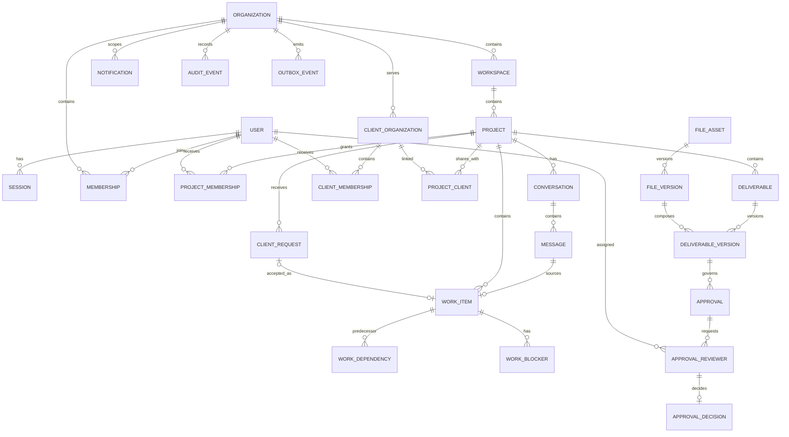
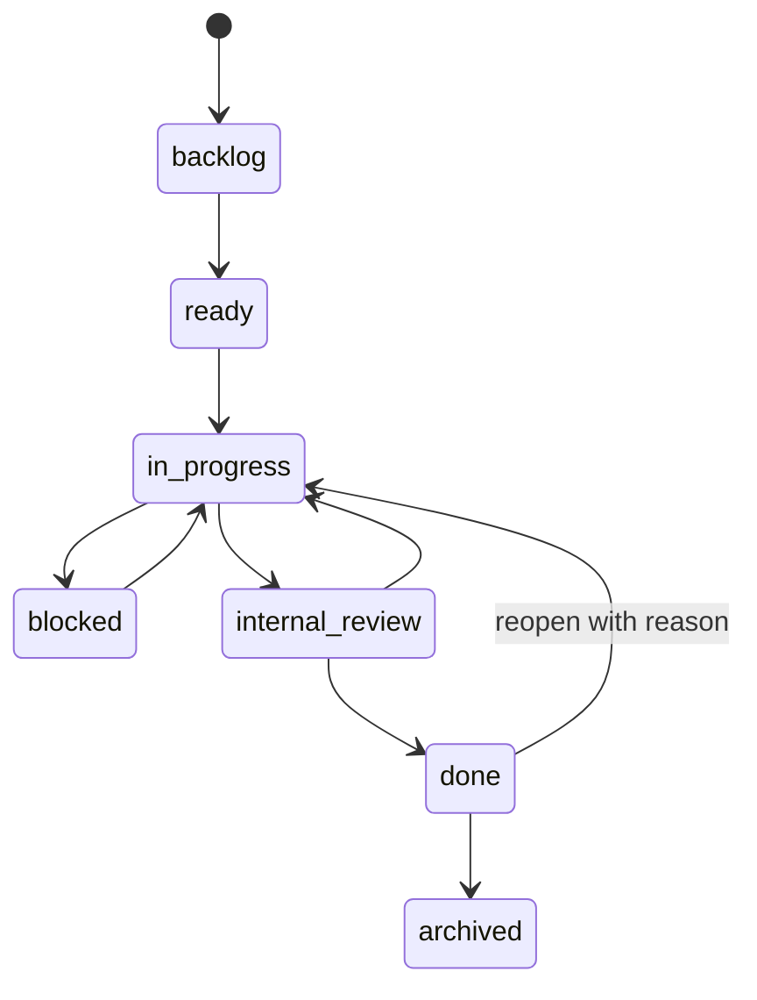
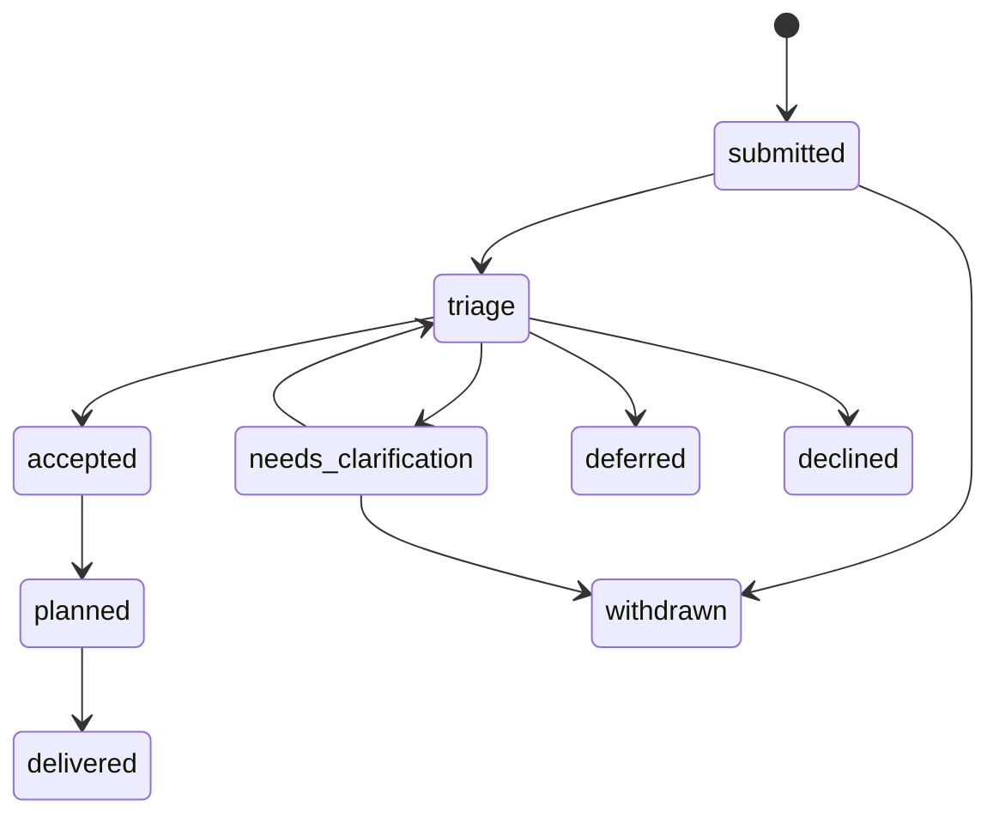
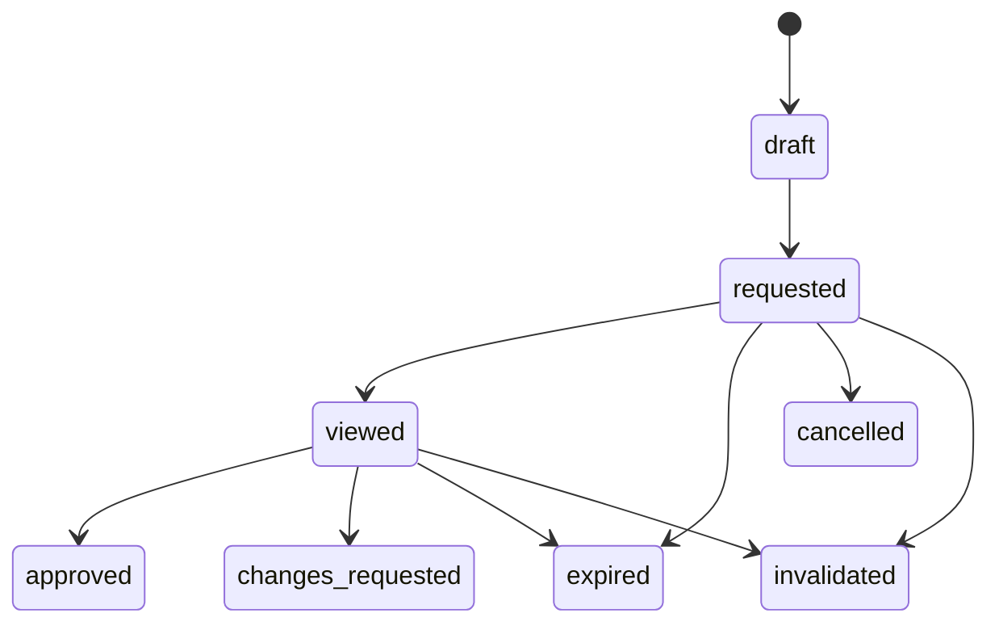

# TManage — ERD, Constraints, and State Machines

## 1. Aggregate boundaries

Identity/Tenancy owns organizations, workspaces, memberships, roles, invitations, sessions. Projects owns projects and project membership. Conversations owns channels/messages/threads. Work owns work items/dependencies/blockers. Files owns assets/versions/uploads. Delivery owns deliverables/versions. Approvals owns approval requests/reviewers/decisions. Clients owns client organizations/memberships/requests/projections. Platform owns notifications, audit, outbox, idempotency.

Cross-aggregate writes occur through application services in one transaction when inside the modular monolith; durable side effects use outbox events. A module may reference another aggregate ID but cannot update the other module’s tables directly.

## 2. Conceptual ERD

## 3. Universal columns

Tenant-owned mutable tables: `id uuidv7`, `organization_id uuid`, `created_at timestamptz`, `updated_at timestamptz`, `version bigint`, optional `deleted_at`. Use UTC. Schedule intent also stores IANA timezone where wall-clock meaning matters. `organization_id` is immutable after creation.

## 4. Key constraints

- Membership unique on `(organization_id, user_id)` for active membership.
- Project membership unique on `(organization_id, project_id, user_id)`.
- Client membership unique on `(organization_id, client_organization_id, user_id)`.
- Every referenced parent must carry the same `organization_id`; enforce via composite foreign keys or triggers/application invariant plus tests.
- Message sequence unique on `(organization_id, conversation_id, sequence_no)`.
- Client-generated message/command ID unique within actor/organization for dedupe.
- One active blocker per work item/reason key; resolved blockers remain history.
- Deliverable version number unique per deliverable and immutable.
- Approval references exactly one immutable deliverable version and its content hash.
- One terminal decision per reviewer per approval version; corrections create superseding record, never overwrite.
- Client projection is immutable per publication revision and contains allowlisted fields only.
- Notification dedupe key unique for recipient/event/action window.
- Idempotency key unique per organization/actor/operation until expiry; stored request fingerprint must match replay.
- Audit/outbox rows are append-only for application role.

## 5. Work item states

Default task: `backlog → ready → in_progress → blocked → in_progress → internal_review → done → archived`.

Allowed alternate transitions: backlog→archived; ready→backlog; in_progress→ready; internal_review→in_progress; done→in_progress only with reopen reason. `blocked` requires blocker reason/ask; leaving blocked resolves active blocker. `done` requires owner and completion timestamp. Project templates can rename display labels but not weaken invariants.

## 6. Client request states

`submitted → triage → needs_clarification → triage → accepted | deferred | declined`; accepted→planned→delivered. Only internal manager may accept/defer/decline. Client may withdraw before delivered. Acceptance requires client-safe scope summary, committed date or explicit unscheduled state, and linked work.

## 7. Deliverable states

`draft → internal_review → ready_for_client → client_review → changes_requested → draft/internal_review → client_review → approved → final → archived`. Publication creates client projection. `approved` is derived from approval policy; `final` requires approved version or authorized waiver with reason.

## 8. Approval states

`draft → requested → viewed → approved | changes_requested | expired | cancelled | invalidated`. If multiple reviewers, aggregate outcome follows policy: all-required, any-one, or ordered sequence. Content hash mismatch prevents decision and invalidates current request.

## 9. Invitation states

`pending → accepted | expired | revoked`. Tokens are single-use, hashed, and never recoverable. Role/scope change after issuance revokes old invitation and issues a new one.

## 10. Upload/file states

Upload: `created → uploading → uploaded → verifying → scanning → ready | rejected | expired | cancelled`. File is inaccessible outside upload owner/authorized processing until `ready`. Replacement creates new file version.

## 11. Offboarding states

`previewed → confirmed → suspending → transferring → reviewing_external_access → completed | failed_partial`. Session revocation occurs at the start of suspending. Partial failure keeps membership suspended and creates admin retry tasks; it never restores access automatically.

## 12. Deletion lifecycle

`active → archived → soft_deleted → purge_queued → purged`; legal/retention hold diverts to `held`. Purge propagates to search, cache, objects, previews, semantic indexes, and eventually backups per published retention. Audit keeps minimum lawful metadata without deleted content.

## 13. Machine-readable companion

`contracts/tmanage-core.dbml` is the MySQL implementation starter. It is conceptual—not a migration—and must be converted into module-owned Drizzle/SQL migrations with strict mode, `utf8mb4`, composite tenant unique/foreign keys, scoped repositories, and isolation tests before code reads production data.
