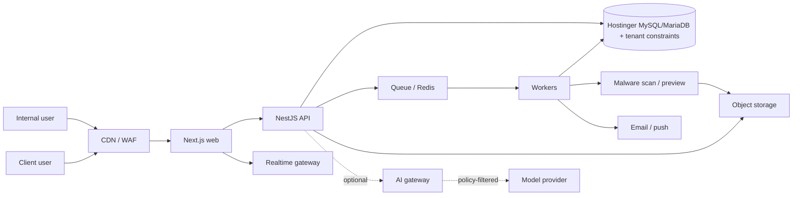
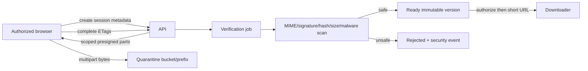

# TManage — Threat Models and Data-Flow Diagrams

## 1. Trust boundaries

TB1 public internet/browser; TB2 edge/CDN/WAF; TB3 web/API application; TB4 realtime gateway; TB5 worker/queue; TB6 database; TB7 object storage/scan/preview; TB8 email/push; TB9 optional AI provider. Internal user and client user are different principal classes even inside the same tenant.

## 2. Core system DFD



Security controls at every crossing: TLS, authenticated principal/service identity, tenant context, authorization, schema validation, rate limits, least privilege, safe logs, correlation ID.

## 3. External publication DFD

```mermaid
sequenceDiagram
  participant M as Manager
  participant API as API/Policy
  participant DB as MySQL/scoped repositories + constraints
  participant C as Client Preview
  participant W as Worker
  M->>API: Request client preview(version, client role)
  API->>DB: Load scoped version + allowed facts
  DB-->>API: Authorized data
  API-->>M: Allowlisted projection + warnings + policy fingerprint
  M->>API: Publish(hash, reviewers, fingerprint, idempotency key)
  API->>DB: Recheck role/hash/policy; write projection+approval+audit+outbox
  DB-->>API: Commit
  API-->>M: Published approval
  W->>DB: Consume outbox; recheck recipient access
  W-->>C: Action notification/deep link
```

### Threats and mitigations

- Internal content leakage through linked objects → allowlisted immutable projection; blocking reference scanner; real-policy preview.
- TOCTOU between preview/publish → policy fingerprint + content hash + transactional recheck.
- Unauthorized publisher → capability + reauthentication for risky policy.
- Cross-client recipient mix-up → reviewer must be active in linked client organization/project.
- Notification after revocation → worker rechecks access immediately before send.
- Link forwarding → short-lived single-use/magic token under policy, bound to invitation/reviewer and reauth for decision.

## 4. Approval DFD and threats

Client loads exact projection/version/hash; server validates reviewer; viewing does not decide; decision transaction locks and rechecks. Threats: replay/double click (idempotency); stale version (hash mismatch/invalidate); CSRF (SameSite + CSRF token); forged reviewer (server session and assignment); repudiation (append-only actor/time/hash/audit); feedback XSS (structured sanitized content); approval after membership removal (current membership recheck).

## 5. File DFD and threats



Threats: polyglot/malware, archive bombs, spoofed MIME, overwrite, key guessing, SSRF in preview, public bucket, long-lived URLs, content-disposition XSS, quota abuse. Controls: signature allowlist, size/decompression limits, sandbox/no egress preview, immutable keys, private bucket, least-privilege worker, short URLs, forced safe disposition, checksum, rate/quota, quarantine.

## 6. Search and AI DFD

Search index consumes safe documents tagged with tenant/audience/client relation. Query candidates are tenant-filtered; final authorization precedes snippet and ranking. AI gateway retrieves only authorized sources, applies prompt-injection boundary, cites source IDs, and sends minimum necessary content according to tenant policy.

Threats: hidden title/snippet leak; stale permission index; prompt injection in documents; model provider retention; cross-tenant embedding/cache; tool-call privilege escalation; hallucinated deadline. Controls: final policy check, permission-version invalidation, instruction/data separation, provider policy, tenant index/cache namespace, normal command authorization, confirmation, source-linked dates.

## 7. Offboarding DFD and threats

Admin reauthenticates → impact preview → confirmation/transfer target → transaction suspends membership and revokes tokens/cutoff → socket disconnect → background ownership transfer/share review → completion receipt. Partial failure keeps access suspended.

Threats: race after preview; forgotten refresh/API token; ownership orphan; client approval assigned to removed user; job failure silently restores access. Controls: recheck version, global session cutoff, credential inventory, required transfer mapping, reassignment queue, fail-closed suspended state, alert/retry/audit.

## 8. STRIDE register

| ID | Threat | Asset | Severity | Required control | Verification |
|---|---|---|---|---|---|
| T-01 | Cross-tenant IDOR/BOLA | all tenant data | Critical | server authz + trusted tenant context + scoped repositories + composite tenant constraints + opaque IDs | AUTH/SEC isolation suite |
| T-02 | Client sees internal content | IP, costs, discussions | Critical | projection allowlist + preview/hash | E2E-04/SEC-07 |
| T-03 | Stolen admin session | organization control | Critical | MFA/passkey, reauth, rotation, detection | SEC-02/SEC-09 |
| T-04 | Malicious upload | users/infrastructure | High | quarantine/scan/sandbox/limits | SEC-06 |
| T-05 | Approval repudiation | contract/delivery record | High | immutable actor/time/hash/audit | E2E-05/INT-16 |
| T-06 | Notification leak after revoke | hidden object metadata | High | current auth recheck before delivery | REL-03/AUTH-14 |
| T-07 | Stored XSS in rich text | sessions/data | High | structured schema, sanitizer, CSP | SEC-08 |
| T-08 | Prompt injection/data exfiltration | tenant knowledge | High | AI gateway, permission retrieval, no auto action | AI-01–AI-07 |
| T-09 | Queue replay/duplicate side effect | decisions/notifications | Medium-high | idempotent consumers, event ID | CONC-04 |
| T-10 | Search/cache side-channel | hidden metadata | High | tenant+policy keys, final auth | SEC-04/SEC-05 |
| T-11 | Offboarding race | access/ownership | High | immediate suspension/cutoff, fail closed | E2E-08 |
| T-12 | Mass export/data theft | tenant corpus | High | reauth, role, throttling, alert, audit | SEC-10 |

## 9. Abuse cases

- Client modifies URL to another project/client/file.
- Member publishes a task linked to internal-only message.
- Removed reviewer reuses an old approval link.
- Manager previews v2 then publishes modified v3 using stale preview.
- Attacker uploads HTML/SVG/polyglot and shares preview.
- Compromised automation attempts role elevation or external publish.
- Search query probes existence by timing/count.
- Owner bulk downloads every file unusually quickly.

Each abuse case becomes a test or detection rule before alpha.

## 10. Threat-model update triggers

New external connector, AI provider/tool call, file type/previewer, public link, mobile/desktop shell, SSO/SCIM, data residency, billing, export type, permission role, or service extraction.
